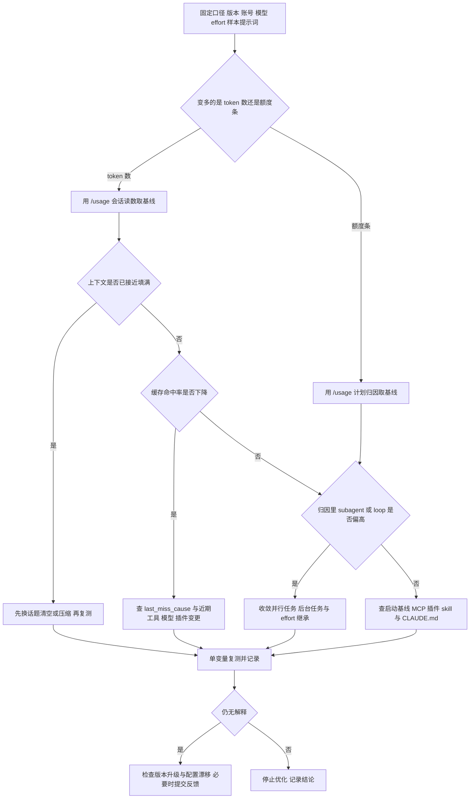

# Claude Code token 消耗排查与优化

> [!abstract] 一句话结论
> 「某些任务 token 明显变多」绝大多数不是单价变了，而是**上下文变长、缓存被打断、或有并行/后台请求在你没输入时继续发请求**这三件事之一。排查顺序应当是：先把感觉换成可测指标 → 看上下文占用 → 看缓存命中 → 看后台与并行 → 最后才动配置；不要一上来就关功能。官方对 2026-10 一轮「额度掉得快」的公开回应也是「未发现单一根因或回归，多数可追溯到一两个重度会话」（B 级，见 §3.3）。

> [!warning] 证据分级与本文局限
> **检索时间 2026-11-07。** 本文是文档梳理，不是本机实测：**没有在本环境运行 Claude Code，所有界面、命令、字段均来自官方公开文档**，凡官方文档未写的一律不补。
> - `[A]` 官方文档 / 官方博客 / 官方 CHANGELOG 明确写出，可直接核对。
> - `[B]` 社区实测、GitHub issue 或媒体转述，**未经一手来源独立核实**，只作线索，不作定量结论。
> - `[?]` 版本差异、渠道表述不一致、或本次检索未能确认，**必须自行复核**。
> 本文不提供任何「优化后省 X%」的承诺；收益必须在你自己的基线上测（§6）。

---

## 零、口径与边界

### 0.1 问题目标

要回答的不是「为什么变贵了」，而是三个可证伪的问题：

1. **哪些请求**在消耗 token（主对话 / subagent / 后台任务 / 辅助请求）？
2. 消耗的是**哪一类** token（新输入 / 缓存读 / 缓存写 / 输出）？
3. 与「以往」的差异来自**分子**（发得更多、上下文更长）还是**分母**（版本、模型、额度窗口、计费方式变了）？

> [!note]- 一个必须先纠正的前提
> 如果没有基线记录，「明显高于以往」本身无法证伪。订阅制用户感知到的通常是**额度条下降速度**，而那是滚动窗口内的相对量，不等于 token 绝对数；API / 云厂商用户看到的才是按 token 计的量。官方明确写道：Pro / Max / Ultra 订阅者的用量已含在订阅内，`/usage` 里的会话金额对账单无意义 `[A]`。混用这两个观测量去对比，是这类排查里最常见的逻辑漏洞。

### 0.2 适用范围

| 维度  | 覆盖                                                                                                                   | 不覆盖                                                   |
| --- | -------------------------------------------------------------------------------------------------------------------- | ----------------------------------------------------- |
| 工具  | Claude Code CLI（交互会话与 `claude -p`）、其 statusline / hooks / subagents / MCP / skills 配置                                | 直接调 Claude API、其他 Agent 产品、Agent SDK 自建 harness 的内部实现 |
| 账号  | 订阅（Pro / Max / Ultra / Team / Enterprise）、API key（Console）、Bedrock / Google Cloud Agent Platform / Microsoft Foundry | 各云厂商账单结算规则细节                                          |
| 问题  | 单会话与计划级用量偏高、长会话爬升、闲置时也在消耗                                                                                            | 模型定价谈判、组织级预算策略、代码质量评估                                 |
| 深度  | 可观测指标 + 官方机制 + 排查路径                                                                                                  | 未公开的调度算法、内部计费公式（无一手资料，不推测）                            |

### 0.3 统计口径

**四类 token**（`[A]`，见 `/usage` 的 `Usage by model` 与 OTel 的 `type` 属性）：

| 类别            | 含义                                              | 常见误读                                       |
| ------------- | ----------------------------------------------- | ------------------------------------------ |
| `input`       | 本次新送入、未命中缓存的输入                                  | 不是「整个上下文」                                  |
| `cache read`  | 从提示缓存读取的 token，按缓存读费率计                          | 数量通常最大，但单价低于标准输入；**长会话每轮都在增长的就是它**         |
| `cache write` | 写入缓存的 token，费率高于读                               | 突然升高 = 前缀被重建                               |
| `output`      | 模型输出，**含思考 token**（thinking tokens 按 output 计费） | spinner 旁的 `↓ x.xk tokens` 只统计本轮输出，不含输入与历史 |

**三个观测层级**，不要互相替代 `[A]`：

- **单轮（turn）**：spinner 旁的实时输出计数、verbose 模式的上下文大小计数。两者口径不同：前者是本轮输出，后者是上下文规模。
- **会话（session）**：`/usage` 的 Session block；`/clear` 会重置（v2.1.211 之前清了也累计，跨 `/clear` 不清零 `[A]`）。
- **计划 / 组织（plan / org）**：`/usage` 的计划用量条与归因、`/insights` 报告、Console / 组织分析、OpenTelemetry 指标。

**费用口径**：`/usage` 与状态行的金额是**客户端按目录价（list price）本地估算**，不是账单 `[A]`。组织可用 `modelPricing` 托管设置改成合约价，但官方明说「该设置改变的是 Claude Code 报告的数字，不是 Anthropic 收的钱」（v2.1.242+）`[A]`。订阅额度窗口按官方说明为**滚动 5 小时 + 周窗口**（Team / Enterprise seat）`[A]`，与 token 数不是线性关系。

### 0.4 版本相关限制

> [!important] 换版本前后不能直接比数字
> 官方 CHANGELOG 在 2.1.310–2.1.319 之间就有多条会改变用量的修复：idle compaction 扩展到更多环境（2.1.314）、父会话不再保留每个 subagent 的工具结果至轮次结束（2.1.314）、后台 subagent 的 shell 命令 3 分钟后转后台以免缓存过期（2.1.318）、`/usage` 修好大缓存未命中不显示（2.1.311）、新增 `CLAUDE_CODE_SUBAGENT_EFFORT`（2.1.316）`[A]`。官方自己在成本文档里提醒：「Claude Code 经常更新，可能改变功能行为，包括成本报告」，并要求用 `claude --version` 核对 `[A]`。

| 限制    | 说明                                                                                                                                                      | 等级                                                                   |
| ----- | ------------------------------------------------------------------------------------------------------------------------------------------------------- | -------------------------------------------------------------------- |
| 命令名   | 当前命令表：`/usage` 是主命令，`/cost` 与 `/stats` 是它的**别名**；帮助中心文章仍用 `/cost` 描述「显示本会话 token 与金额（API 计费）」。两者不是两个功能，是入口名与表述侧重不同                                      | `[A]` `/cost` 别名；`[?]` 帮助中心文章的更新日期只写 "Updated over a week ago"，无精确版本 |
| 功能门槛  | `/usage` 的 `Prompt cache (main)` 行需 v2.1.251+；`last_miss_cause` 需 v2.1.260+；Loops 行需 v2.1.242+；`f` 快捷键需 v2.1.305+；状态行 `prompt_cache` 对象需 v2.1.251+      | `[A]`                                                                |
| 模型相关  | 1M 上下文、`/effort` 档位、能否关闭 thinking 都随模型而变；Opus 5.5 / Sonnet 5.5 / Haiku 5.5 / Fable 系列**不能关闭扩展思考**                                                       | `[A]`                                                                |
| 未能确认  | MCP 文档的 `Scale with MCP tool search` 章节在本次抓取中未完整返回，「工具描述超过上下文 10% 自动延迟加载」仅见于旧版/翻译镜像，**不引为结论**；`ENABLE_TOOL_SEARCH=false` 与 `--strict-mcp-config` 则有一手依据 | `[?]` / `[A]`                                                        |
| 本地未实测 | 本文所有界面与字段以官网文档为准；你的版本、账号、插件组合可能不同                                                                                                                       | `[?]`                                                                |

---

## 一、新对话默认上下文：查看入口与组成口径

### 1.1 查看入口

| 入口             | 看到什么                                                          | 口径 / 限制                                                                           | 等级          |
| -------------- | ------------------------------------------------------------- | --------------------------------------------------------------------------------- | ----------- |
| `/context`     | 「把当前上下文占用可视化为彩色网格」，给出针对占空间大的工具、记忆膨胀与容量告警的优化建议；超出窗口时附带超出量与释放命令 | 官方命令表写 `/context [all]`：全屏模式下明细会被折叠，`all` 可展开                                     | `[A]`       |
| `/context all` | 展开逐项明细                                                        | 官方 `context-window` 页说 `/context` 给出「按类别的实时明细，包括加载了哪些 CLAUDE.md 与 auto memory 文件」 | `[A]`       |
| 自定义状态行脚本       | 读取 stdin JSON 的 `context_window` 对象，常驻显示占用比例                  | **不是内置开关**，要自己写脚本并在 settings 里配置；见 §2.4                                           | `[A]`       |
| `/mcp`         | 已配置的 MCP server 列表、连接状态、每个 server 的工具数                        | 交互面板；`-p` 非交互模式下无参数运行会打印文本摘要                                                      | `[A]`       |
| `/memory`      | 打开并编辑记忆文件                                                     | 官方 `context-window` 页明确指向它查看已加载的 CLAUDE.md / auto memory                          | `[A]`       |
| 上下文占用实时指示      | 帮助中心描述为「Claude Code 显示上下文窗口的实时指示」                             | 帮助中心措辞，未给出具体界面控件名；不与上面几个入口混为一谈                                                    | `[A]` 但描述较粗 |

> [!note]- `/context` 与状态行会不一致，这不是 bug
> 官方文档写明：状态行报告的是**最近一次 API 响应**的数值，而 `/context` 会额外加上该响应之后新增消息的估算，因此 `/context` 可能读数更高，直到下一次响应才对齐；官方建议用 `used_percentage` 作为最简准确的状态 `[A]`。

### 1.2 启动即加载的清单（组成口径）

官方 `context-window` 页对「你还没输入任何内容时」的原文列举 `[A]`：

> CLAUDE.md、auto memory、MCP tool names、skill descriptions 都会加载进上下文；AGENTS.md 可以替代 CLAUDE.md；你自己的配置还可能额外加 output style 或 `--append-system-prompt` 文本。

按加载时机归并成一张表：

| 层      | 内容                                                             | 加载时机 | 变化触发                             |
| ------ | -------------------------------------------------------------- | ---- | -------------------------------- |
| 静态系统提示 | 核心指令、内置工具定义                                                    | 会话启动 | 工具定义集合变化                         |
| 项目上下文  | 项目根 `CLAUDE.md`、auto memory、无 `paths:` 的 rules、skill **描述**    | 会话启动 | 会话启动 / `/clear` / `/compact` 后重载 |
| 对话层    | 你的消息、Claude 的回复、工具结果、文件读取                                      | 每轮追加 | 每一轮                              |
| 按需     | 嵌套 `CLAUDE.md`、带 `paths:` 的 rules、skill **正文**、MCP 工具完整 schema | 命中时  | 读到对应目录 / 调用 skill / 工具搜索命中       |

前三层顺序来自官方 `prompt-caching` 文档的缓存分层表，`按需` 一层来自官方博客对 `defer_loading` 的说明（只放工具名 stub，完整 schema 在工具被选中时才加载）`[A]`。

> [!warning] 「默认占用」是基线，不是异常来源
> 官方 `context-window` 页用的是**代表性 token 数**做演示，并明确要求「要看你自己的实际占用，跑 `/context`」`[A]`。**本文档不给出「新会话固定占用 N token」这类数字**——它随账号、插件、MCP server 数量、CLAUDE.md 长度、模型与版本变化。谁给你一个固定数字，先问是哪个版本、哪套配置下测的。

### 1.3 压缩时的组成变化（容易误判为「又涨了」）

`/compact` 后各机制的存活情况 `[A]`：项目根 `CLAUDE.md` / 无路径 rules / auto memory 从磁盘重新注入；skill 描述重建并重新注入（v2.1.304+）；已调用的 skill 正文重新注入但有**每 skill 5,000 token、总计 25,000 token** 上限，旧的先丢；path-scoped rules 与嵌套 CLAUDE.md 按需重新加载；最近修改过的文件最多重读 5 个，超过 5,000 token 的文件只留路径引用。

所以「压缩完上下文没降多少」可能是上述重新注入造成的，而不是压缩失效。

---

## 二、单个对话的用量：查看维度、指标含义与记录方式

### 2.1 四个观测层级

| 层级 | 入口 | 回答的问题 | 粒度 |
| --- | --- | --- | --- |
| 单轮 | spinner 旁 `↓ x.xk tokens`、verbose 模式计数 | 这一轮产生了多少输出 / 上下文多大 | 每轮重置；压缩时重置 |
| 会话 | `/usage` Session block、`/context` | 这个会话累计花了多少、现在装了什么 | `/clear` 重置 |
| 计划 | `/usage` 的 plan usage bars / 归因 / 建议 / Loops | 近 24 小时或 7 天里，哪些行为在吃额度 | 按 `d` / `w` 切换；本机本地历史估算 |
| 跨会话 / 组织 | `/insights`、Console / 组织报表、OpenTelemetry | 长期趋势、按人按模型拆分 | 天 / 周；OTel 近实时 |

### 2.2 `/usage` Session block 逐指标

官方文档给出的示例（**取自官网示例，非本机实测**）`[A]`：

```text
Total cost:            $0.55
Total duration (API):  6m 20s
Total duration (wall): 6h 33m 10s
Total code changes:    0 lines added, 0 lines removed
Usage by model:
   claude-sonnet-4-6:  1.2k input, 5.3k output, 940.0k cache read, 50.0k cache write ($0.55)
```

| 指标 | 含义 | 排查价值 |
| --- | --- | --- |
| `Total cost` | 本地按目录价估算的会话金额 | 只是估算，别当账单；订阅用户基本可忽略 |
| `Total duration (API)` vs `(wall)` | 等待 API 的累计时间 vs 会话运行墙钟时间 | 上面示例 6 分钟 vs 6 小时：**挂了一整天的会话**正是长上下文 / 缓存过期的典型温床 |
| `Usage by model` 四类 | 按模型拆的 input / output / cache read / cache write | `cache read` 巨大 = 上下文很长；`cache write` 突增 = 前缀被重建 |
| `Prompt cache (main)` | 主会话的请求数、缓存读占输入比例、miss 次数与 token 数、冷/暖状态、TTL（v2.1.251+） | **排查消耗升高的第一手指标**；可给出 `likely cause: tool definitions changed` 这类归因（v2.1.260+）；只统计主会话，**不含 subagent** |
| `Total code changes` | 增删改行数 | 与 token 对比，可识别「花了很多但没产出」的循环 |

`Plan usage breakdown` 里三个易读错的点 `[A]`：

- **Attribution**：把近期用量按 skills / subagents / plugins / 单个 MCP server 归因成百分比。v2.1.222 之前有归因 bug（调用一次 MCP 后，后续所有请求都算到它头上，会高估其占比）。
- **Recommendations**：每行开头的百分比是「**这一行适用于你多少比例的用量**」，**不是「改了能省多少」**；一行请求可计入多行，百分比之和可超过 100%。
- **Loops**：按总 token 排序列出最重的 `/loop` 等会话级定时任务（v2.1.242+），含触发频率、运行次数、总/单次 token、上次运行时间。`f` 修复快捷键仅对部分行生效（v2.1.305+），带 `run` 前缀的行要自己执行。

### 2.3 状态行脚本可用的字段（常驻监控）

配置自定义状态行后，脚本从 stdin 读 JSON `[A]`：

| 字段                                                                      | 含义                                                                                                                  |
| ----------------------------------------------------------------------- | ------------------------------------------------------------------------------------------------------------------- |
| `context_window.used_percentage` / `remaining_percentage`               | 已用 / 剩余百分比；**只算输入侧**（`input_tokens + cache_creation_input_tokens + cache_read_input_tokens`），**不含 `output_tokens`** |
| `context_window.current_usage.*`                                        | 四类 token 分类值；首次 API 调用前与 `/compact` 后可能为 `null`                                                                     |
| `context_window.context_window_size`                                    | 窗口上限，默认 200000，扩展上下文模型为 1000000                                                                                     |
| `cost.total_cost_usd` / `total_api_duration_ms` / `total_duration_ms`   | 估算成本、等待 API 时间、会话墙钟时间                                                                                               |
| `prompt_cache.hit_ratio` / `warm` / `misses` / `last_miss_cause.causes` | 会话级缓存命中率、是否暖、miss 次数、最近一次 miss 的可能原因（v2.1.251+ / 2.1.260+）                                                          |

`last_miss_cause.causes` 的官方取值举例：`tools_changed`、`system_prompt_changed`、`ttl_expired_5m`、`likely_server_side` `[A]`。**这几个值基本就是排查路径的路标**。

### 2.4 其他查看方式

- **跨会话行为分析**：`/insights` 生成 HTML 报告写到 `~/.claude/usage-data/report.html`，分析的是「你怎么工作、哪里卡住」，不是 token 计数；单次最多分析 200 个未分析过的会话，其自身调用也会计入用量 `[A]`。
- **组织级 / 长期趋势**：OpenTelemetry 指标 `claude_code.token.usage`（单位 `tokens`，属性 `type` 取 `input` / `output` / `cacheRead` / `cacheCreation`）与 `claude_code.cost.usage`（单位 `USD`），每次 API 请求后递增；带 `model`、`query_source`（`main` / `subagent` / `auxiliary`）、`effort`、`agent.name`、`skill.name`、`mcp_server.name` 等属性。启用需 `CLAUDE_CODE_ENABLE_TELEMETRY=1` 与 `OTEL_METRICS_EXPORTER` `[A]`。
- **一次性可复现测量**：官方给出 `claude -p "hello" --output-format json` 并读取 `usage.cache_creation` 来确认缓存 TTL `[A]`；同一思路可用于固定提示词的输入 token 对比（见 §6.3）。
- **不要拿这些当 token 数**：spinner 计数（只算本轮输出、不含输入与历史）、verbose 计数（算上下文规模）、`/usage` 的 plan 百分比（算额度占比）三者口径都不同 `[A]`。

### 2.5 记录方式（本文建议，非官方功能）

> [!tip] 最小可用记录表
> 每次样本任务记一行，字段固定，**缺一项就别拿来做前后对比**：
>
> | 字段 | 记什么 |
> | --- | --- |
> | 身份 | 日期、`claude --version`、登录方式（订阅 / API / 云）、模型全名、effort |
> | 任务 | 固定提示词或任务编号、仓库 / 目录、是否新会话 |
> | 上下文 | `/context` 的各类占比、状态行 `used_percentage` |
> | 用量 | `/usage` 的 input / output / cache read / cache write、`Total duration (wall)` |
> | 缓存 | `hit_ratio`、`misses`、`last_miss_cause`、`ttl` |
> | 归因 | `/usage` 归因里 subagent / skill / MCP / loops 的占比 |
> | 变更 | 本轮只改了哪一个变量、改前改后的完整读数 |
>
> 三种记录强度：**手工表**（够用于个人排查）→ **状态行脚本常驻**（能看到趋势，但要处理 `null`）→ **OTel 导出**（跨人跨会话、可画图，代价是要搭 collector，且注意属性里含 `user.email` 等标识 `[A]`）。

---

## 三、消耗升高的常见来源：分类与判定线索

### 3.1 分类总表

前三列的机制与官方「Why usage climbs in a long session」章节一致 `[A]`；判定线索中带 `[B]` 的为推断或社区经验。

| # | 来源 | 机制 | 判定线索 | 优先验证动作 |
| --- | --- | --- | --- | --- |
| 1 | **长上下文** | 每轮都重发完整对话；每次工具调用又带一批工具结果再发一次请求，即使命中缓存也按缓存读计费 | `cache read` 巨大且逐轮增长、`used_percentage` 高、`Total duration (wall)` 远大于 API 时长 | `/context` 看组成；换无关任务前 `/clear` 后复测 |
| 2 | **缓存未命中** | 间隔超过缓存 TTL 后第一条请求重建全部上下文；或前缀被改动 | `Prompt cache (main)` 的 `misses` 上升、`cache write` 突增、`last_miss_cause` 给出 `tools_changed` / `system_prompt_changed` / `ttl_expired_5m` | 对照 §3.2 的失效动作清单，回想上一轮改了什么 |
| 3 | **模型 / effort / thinking** | 思考 token 按 output 计费，默认预算「依模型可达每请求数万 token」；`max` 档「可能收益递减且容易过度思考」 | `output` 明显偏高但文件读取不多；subagent 继承了会话的高 effort | `/effort status`、`/model`；核对 `CLAUDE_CODE_SUBAGENT_EFFORT`（2.1.316+ 新增） |
| 4 | **闲置时的请求** | 定时任务在空闲时照常触发并发送完整上下文；跨会话消息投递、目标 check-in、session recap、idle compaction、提示建议都会在空闲时产生请求 | 人没输入但额度下降；`/usage` Loops 行有运行记录；`requests` 数大于你的消息数 | 看 Loops 行、`crossSessionInbound`、`idleCompaction`、`CLAUDE_CODE_GOAL_CHECKIN_MINUTES` |
| 5 | **subagent / workflow / agent teams** | 每个实例有自己的上下文窗口与自己的请求；teammate 不退出就持续消耗 | 归因里 subagent 占比高；官方说 plan mode 下 agent teams 约为标准会话的 **7 倍** token | 缩小团队、缩短 spawn prompt、及时关闭 teammate、给 subagent 指定更便宜的模型 |
| 6 | **MCP / 插件 / 工具集变化** | 工具定义在缓存前缀里，中途增删会使整段缓存失效；未启用工具搜索时全量 schema  upfront 进入上下文 | `last_miss_cause` = `tools_changed`；`/mcp` 里连接了大量 server；`claude -p --tools ""` 场景下输入异常高 `[B]` | 用 `/mcp` 禁用不用的 server；核对 `ENABLE_TOOL_SEARCH` 是否被关；脚本化调用考虑 `--strict-mcp-config` |
| 7 | **压缩本身** | `/compact` 要读它要总结的对话，是一次大请求；冷缓存时恢复旧会话再压缩最贵 | 刚 `/compact` 完读数不降反升 | 在自然断点压缩；要彻底重开用 `/clear`（官方明确 "`/clear` costs nothing"） |
| 8 | **配置 / 版本漂移** | 升级通常改系统提示或工具定义，升级后第一个会话从头建缓存；`CLAUDE.md`、插件、marketplace 变更同样改变基线 | 升版本后同一任务读数整体抬升，`system_prompt_changed` | `claude --version`；把版本写进记录表，跨版本不直接比 |
| 9 | **宽泛提示词导致反复读文件** | 官方：「improve this codebase」这类请求会触发大范围扫描；方向错了还要返工 | `Total code changes` 低而 token 高；反复出现同类文件读取 | 给具体文件 / 函数 / 验证目标；复杂任务先用 plan mode，`Escape` 早纠偏、`/rewind` 回滚 |

### 3.2 反直觉的三件事（别按常识优化）

> [!important] 缓存前缀是整段匹配的
> 官方博客与 `prompt-caching` 文档都写明：`system prompt → project context → conversation` 三层按序拼接，**前缀任何位置一改，后面全部重算**；没有按文件、按片段的缓存 `[A]`。由此：
>
> 1. **会话中途换便宜模型可能更贵**——每个模型有独立缓存，官方博客举的例子是「Opus 上 100k token 的会话，切 Haiku 回答一个简单问题，比让 Opus 直接答更贵，因为要重建缓存」。要用小模型，走 subagent（独立窗口）。
> 2. **中途增删工具比多放几个工具定义更贵**——官方博客把「中途加/删工具」列为最常见的破坏缓存方式，正确做法是 `defer_loading` 保留 stub，而不是移除。
> 3. **`/compact` 不是免费的**——它自身是一次请求；缓存暖时读前缀较便宜，冷时（尤其是恢复旧会话）要按未缓存输入重处理整段历史 `[A]`。

官方列出的缓存失效动作：切换模型、改 effort（多数模型）、开关 fast mode、连接/移除 MCP server、启用/禁用插件、deny 整个工具、`/compact`、累积图片被批量清除、升级 Claude Code `[A]`。对应地，编辑仓库文件、中途编辑 `CLAUDE.md`（改动要到 `/clear` / `/compact` / 重启才生效）、切权限模式、调用 skill / 命令、`/recap`、`/rewind`、派 subagent 都**不破坏**父会话缓存 `[A]`。

### 3.3 关于「最近突然变快」的公开回应

- `[B]` 2026-10-28，Claude Code 负责人 Boris Cherny 在 X 上回应一轮「额度掉得快」投诉：团队逐个查看用户提交的 session ID，**未发现单一根因，也未发现 Claude Code 回归**；找到几处让部分会话多耗 token 的小问题并在推送修复；多数快速消耗可追溯到一两个重度会话，如 `xhigh` effort、`/goal`、Workflows、Agent Teams、长时间 SDK 任务；子 agent 默认继承会话 effort 容易叠加。原帖中的「快 5 倍」是用户说法、非官方数据。
- `[A]` 可交叉印证的**官方事实**：agent teams 在 plan-mode teammate 下约 7 倍 token；`CLAUDE_CODE_SUBAGENT_EFFORT` 在 2.1.316 加入，可让 subagent 不再继承会话 effort；2.1.311 修好 `/usage` 不显示大缓存未命中，2.1.314 / 2.1.318 有多条后台与缓存相关修复。
- `[B]` 另有媒体转述「后台 subagent 状态行每 30 秒重读全文、改用 Haiku 5.5 生成后单次降约 99%、整会话约降 5%」的说法。**本次检索在官方 CHANGELOG 未找到对应条目**，因此不采信具体百分比，仅记为「后台状态/摘要请求曾是争议点」这一线索。
- 摩擦一句：把「我这两天用得快」直接归因于「平台偷偷改了」，在没有版本记录、没有 `/usage` 归因、没有固定任务复测之前，只是猜想。上面这份官方回应恰恰说明，先查自己的一两个重度会话，通常比等公告更快。

---

## 四、按优先级排列的逐步排查路径

> [!tip] 原则
> 每一步只回答一个是/否问题，只改一个变量，改完用**同一个固定提示词**复测并记进 §2.5 的表。没有基线就不要进入优化环节。



| 优先级    | 做什么                                                                 | 看哪个指标                                                                  | 判定 / 下一步                                                                                                                      |
| ------ | ------------------------------------------------------------------- | ---------------------------------------------------------------------- | ----------------------------------------------------------------------------------------------------------------------------- |
| **P0** | 固定口径：`claude --version`、登录方式、`/model`、`/effort status`、固定样本提示词、同一目录 | 记录表                                                                    | 版本/模型/effort 任一与「以往」不同 → **先归为分母变化**，不要用旧基线比                                                                                  |
| **P1** | `/context` 看组成，`/usage` 取四类 token 基线                                | `used_percentage`、`cache read`、`Total duration (wall)`                 | 上下文大且挂了很久 → 来源 1；先做「换无关任务前 `/clear`」的对照实验，这是官方称为「对质量与成本最有效的单一杠杆」的动作 `[A]`                                                     |
| **P2** | 查缓存                                                                 | `hit_ratio`、`misses`、`cache write`、`last_miss_cause`                   | 命中率下降或 miss 增多 → 来源 2 / 6 / 8；按 §3.2 清单找最近一次「改了模型 / 工具 / 插件 / effort」                                                         |
| **P3** | 查后台与并行                                                              | `/usage` 的 Loops 行、Attribution 百分比、`requests` 与你的消息数之差                 | 空闲也涨 → 来源 4 / 5；优先收敛定时任务、goal check-in、未退出的 teammate，而不是压上下文                                                                  |
| **P4** | 查启动基线                                                               | `/mcp` 的 server 与工具数、`/context` 里 CLAUDE.md / auto memory / skill 描述占比 | 新会话第一条就异常高 → 来源 6；核对工具搜索是否被关、`--tools ""` 的用法、是否需要 `--strict-mcp-config`                                                      |
| **P5** | 查版本与配置漂移                                                            | CHANGELOG、`/status`、`git log`（`CLAUDE.md` / settings）                  | 抬升发生在升级后第一会话 → 来源 8；等缓存重建后再取基线，不要拿第一请求下结论                                                                                     |
| **P6** | 隔离实验                                                                | 固定提示词 + 单变量                                                            | 用 `claude -p "固定提示词" --output-format json` 读 `usage`，A/B 各跑 3 次取中位数；仍无解释 → 记录证据并用 `/feedback` 上报，附 session ID `[A]` 文档建议的排障路径 |

> [!note]- 官方给的自助入口
> 订阅用户可直接跑 `/usage`，其 breakdown 会针对「占最近用量 ≥10% 的行为」给出建议行，并显示 `f to fix x of y` 提示（v2.1.305+）`[A]`。**注意 `f` 会让 Claude 真的去改配置**（例如直接执行 `/effort` 命令），按官方说明它会先把每处改动展示给你；带 `run` 的行不会被自动执行。别在没弄清改的是哪个文件前按下去。

---

## 五、优化措施：预期影响、验证指标与风险边界

**读表前须知**：除明确标注的官方数字外，「预期影响」只给方向与量级描述，**不给百分比承诺**。所有收益依赖你的上下文规模、缓存状态与任务类型，必须在 §6 的基线上测。

### 5.1 会话与上下文管理

| 措施 | 适用条件 | 预期影响 | 验证指标 | 风险边界 | 等级 |
| --- | --- | --- | --- | --- | --- |
| 换无关任务前 `/clear` | 下一句提示在新终端里也读得通 | 官方称「对质量和成本最有效的单一杠杆」；`/clear costs nothing`，而 `/compact` 本身是一次大请求 | 新会话首轮 `cache read`、`Total cost`、`/context` 占比 | **不可撤销**；官方明确提醒需要历史就先复制出来或改用 `/compact`；可先 `/rename` 再用 `/resume` 找回 | `[A]` |
| 任务中途 `/compact [focus]` | 需要延续当前任务 | 缩短后续每轮上下文 | `used_percentage`、`Prompt cache (main)` | 压缩本身要花钱，冷缓存时最贵；会丢细节；可在 `CLAUDE.md` 写 `# Compact instructions` 指定保留什么 | `[A]` |
| `/rewind` 回退错误方向 | 走错路想重来 | 截断到**已缓存的前缀**，比压缩更省 | 后续 `cache write` | 会连同代码检查点一起回退，先确认改动范围 | `[A]` |
| 用路径引用代替粘贴；`@` 前缀会注入整个文件及其 CLAUDE.md 树 | 日志、大文件、stack trace | 减少常驻内容；官方建议日志裁剪到相关 20–30 行 | `/context` 明细、首轮 input | 引用不足会让 Claude 多读几轮；需要精确内容时别省 | `[A]`（帮助中心） |
| 精简 `CLAUDE.md`、把流程性指令搬进 skills / 加 `paths:` 的 rules | 项目根文件很长、含特定工作流说明 | 降低**每轮**的基线占用；官方建议控制在约 200 行内 | `/context` 里项目上下文占比、首轮 `cache read` | 删掉非推断事实会提高纠错成本；路径规则有版本门槛（2.1.198+，Write/Edit 触发 2.1.288 才补齐）；中层改动要 `/clear` 才生效 | `[A]` + 本项目 `README.md` |

### 5.2 模型、推理与缓存

| 措施 | 适用条件 | 预期影响 | 验证指标 | 风险边界 | 等级 |
| --- | --- | --- | --- | --- | --- |
| 会话开始就定好模型与 effort，中途不切 | 所有长会话 | 保住缓存前缀；官方博客把「中途换模型」「中途增删工具」列为破坏缓存的典型方式 | `hit_ratio`、`misses`、`last_miss_cause` | 与「简单任务换便宜模型」的直觉冲突；要用小模型请走 subagent | `[A]` |
| `/effort` 降到 `low` / `medium`，简单 subagent 指定 `model: haiku` 或设 `CLAUDE_CODE_SUBAGENT_EFFORT` | 机械改动、批量脚本、简单子任务 | 官方：低 effort 更快更省；思考 token 按 output 计费 | `output` token、`Usage by model` | 降太多导致返工，总成本可能反升；`max` 官方明说「可能收益递减、容易过度思考」；Opus 5.5 / Sonnet 5.5 / Haiku 5.5 / Fable 系列**不能关思考**；effort 档位随模型不同，同名不同强度 | `[A]` |
| `MAX_THINKING_TOKENS`（固定思考预算模型） | 确认为 fixed thinking budget 模型 | 限制单次思考预算 | `output` | 自适应推理模型会忽略非零预算，应改用 effort；对多数新模型无效 | `[A]` |
| 减少缓存失效动作、按自然断点压缩 | 长会话、频繁切配置 | 官方博客把缓存命中率当基础设施指标监控 | `hit_ratio`、`cache write` | 为了保缓存而长期不 `/clear`，会累积更多 cache read；两者要平衡 | `[A]` |
| 调整缓存 TTL（`promptCacheTtl` / `CLAUDE_CODE_PROMPT_CACHE_TTL`，v2.1.242+） | 经常离开再回来、且用 API/额度计费 | 1 小时 TTL 可跳过冷启动重建 | `ttl`、`misses`、`cache write` | 1 小时 TTL 的**缓存写费率更高**，短促不空闲的工作反而更贵；订阅内用量默认主会话已是 1h；网关需转发 `anthropic-beta` 头 | `[A]` |
| 1M 上下文 / `CLAUDE_CODE_DISABLE_1M_CONTEXT=1` | 超大仓库 vs 想强制早压缩 | 前者能装更多，后者让会话在 200K 边界压缩 | `context_window_size`、`used_percentage` | **1M 不是降价**：Haiku 5.5 在 prompt 超过 100K 后单 token 更贵；`[1m]` 可用性依套餐；网关下 Claude Code 检测不到下游更低的上限 | `[A]` |

### 5.3 工具、并行与后台

| 措施                                          | 适用条件                           | 预期影响                                                        | 验证指标                                       | 风险边界                                                                                 | 等级                             |
| ------------------------------------------- | ------------------------------ | ----------------------------------------------------------- | ------------------------------------------ | ------------------------------------------------------------------------------------ | ------------------------------ |
| `/mcp` 禁用不用的 server；优先用 `gh` / `aws` 等 CLI  | 装了多个 MCP server 但任务用不上         | 官方：CLI 不添加任何 per-tool 定义；工具定义默认延迟加载，只有工具名与 server 指令常驻      | `/context` 工具占比、`last_miss_cause`          | 中途增删 server 会打断缓存，**应在会话开始前决定**；禁用会损失能力                                              | `[A]`                          |
| 脚本化调用用 `--strict-mcp-config`                | `claude -p` 且不需要 claude.ai 连接器 | 官方：只用 `--mcp-config` 传入的 server                             | 单次 `usage` 的 input                         | 会连带排除你确实需要的 MCP；v2.1.246 前 strict 会话仍可能等待审批                                          | `[A]` 标志；`[B]` 具体收益数字见 §7 场景 C |
| 把大输出（日志、测试、文档抓取）交给 hook 预处理或 subagent       | 日志/测试输出动辄上万行                   | 官方举例：hook 只 grep `ERROR` 行，可把「数万 token」降到「数百」；subagent 只回摘要 | 主会话 `cache read`、attribution 的 subagent 占比 | hook 过滤可能漏掉关键错误；subagent 自身请求**照样计费**     | `[A]` + 本项目实测 `[A]`            |
| 收敛 agent teams / workflows / `/goal` / 定时任务 | 后台与并行用量高                       | 官方：teammate 数与 token 近似成正比，plan mode 下约 7 倍；关闭不用的 teammate  | Loops 行、Attribution、`requests`             | 并行度下降会拉长墙钟时间；`CLAUDE_CODE_GOAL_CHECKIN_MINUTES=0` 会关掉 idle check-in（v2.1.236+ 才有该机制） | `[A]`                          |
| 装代码智能插件（LSP）减少盲目读文件                         | 类型化语言、陌生大型仓库                   | 官方：一次 go-to-definition 取代 grep + 读多个候选文件                    | 文件读取次数、input                               | `[B]` 有社区 A/B 实测称在此类任务上并不省 token（见 §6.5）；启用插件本身可能触发一次缓存重建                            | `[A]` 主张 / `[B]` 效果            |
| 写具体提示词 + plan mode + 早 `Escape` 纠偏          | 涉及多文件的复杂改动                     | 官方：避免宽泛扫描与推倒重来                                              | `Total code changes` 与 token 之比            | 过度前置规划也有成本；官方帮助中心建议「A plan costs a few hundred tokens，一个错误的 400 行 diff 要花几千，还要两遍」    | `[A]`                          |

### 5.4 观察侧措施

| 措施 | 预期影响 | 验证指标 | 风险边界 | 等级 |
| --- | --- | --- | --- | --- |
| 配置状态行常驻显示 `used_percentage` 与 `hit_ratio` | 让异常在发生时可见，而非事后猜 | 状态行读数 | 脚本要处理 `null`；`/compact` 后 `current_usage` 会短暂为 `null` | `[A]` |
| 导出 OTel 指标做长期趋势 | 跨会话、按模型/来源拆分 | `claude_code.token.usage`、`claude_code.cost.usage` | 属性默认含 `user.email` / `user.id`；`agent.name` / `skill.name` / `mcp_server.name` 默认脱敏，`OTEL_LOG_TOOL_DETAILS=1` 会显示真实名称；官方明确 Claude Code 忽略项目级 `.claude/settings.json` 里的 exporter 变量 | `[A]` |
| 组织设 `modelPricing` | 让报告贴近合约价 | `Total cost` 行出现 `at your organization's configured rates` | **只改显示不改账单**；只认 managed settings；仍是估算 | `[A]` |

---

## 六、持续观察与对比方法

### 6.1 先建基线，再谈优化

选 3–5 个**可重复**的代表任务（例如「给某函数加参数校验」「跑一次单测并解释失败」「读三个文件回答架构问题」），每个任务固定提示词、固定目录、固定模型与 effort。在新会话里各跑 3 次，取四类 token 的**中位数**作基线。至少连续记 3–5 个工作日，覆盖「刚开会话」与「挂了几小时」两种状态。

### 6.2 单变量原则

一次只改一件事（例如「换任务前 `/clear`」），其余字段全部保持不变；改后同样跑 3 次取中位数。若同时改了模型、effort 和 CLAUDE.md，读数变化无法归因——这是这类对比最常见的失效方式。

### 6.3 可复现的轻量测法

```bash
# 固定提示词，读取单次调用的 usage（官方给的 --output-format json 用法）
claude -p "固定提示词" --output-format json | jq '.usage'

# 官方用于确认缓存 TTL 的写法
claude -p "hello" --output-format json | jq '.usage.cache_creation'
```

`[A]` 以上命令形态来自官方文档；`[?]` **本环境未执行验证**，且 `-p` 调用的账号、MCP 加载与交互会话不同，结果只能用于**同配置下的 A/B 自比**，不能外推到交互会话。

### 6.4 必须控制的干扰项

| 干扰项 | 为什么会让对比失真 |
| --- | --- |
| 版本升级 | 系统提示/工具定义变化，升级后首个会话从头建缓存 `[A]` |
| 缓存冷/暖 | 间隔超过 TTL（5m 或 1h，依账号与设置）后的第一条请求会重建全部上下文 `[A]` |
| 目录与 git 状态 | 官方：缓存实际按「一台机器 + 一个目录」作用域；系统提示含 auto memory 路径，会话开头带工作目录/平台/shell 声明；顺序会话还要 git status 快照一致才能共享前缀 `[A]` |
| 模型 / effort / fast mode | 各自独立缓存，任一切换都会重建 `[A]` |
| 订阅窗口 | 5 小时滚动 + 周窗口，跨窗口比「额度条」没有意义 `[A]` |
| 后台任务 | 定时任务、goal check-in、跨会话消息会在两次测量之间偷偷发请求 `[A]` |
| 账号口径 | 订阅用户 `/usage` 的会话金额对账单无意义；云端用量不回传 Anthropic 的分析看板 `[A]` |

### 6.5 什么时候该停

`[B]` 有社区实测（经二手中文技术文转述，未直连原帖）逐项测试微观优化：把工具输出截到 4,000 / 2,000 token 最多省 4.2% / 9.2%，重复文件去重最多 2.1%，工具定义排序无空间（缓存未命中仅占 1.7%），代码索引 56 次 A/B 在部分任务上反而更贵；相关 issue 以 "not planned" 关闭。**这些数字未经一手核实，只用来说明一个方向**：当 `hit_ratio` 已经很高、`/context` 里没有明显大头时，继续做微观裁剪的收益通常是低个位数，不值得牺牲可维护性。

停止条件建议：连续两轮单变量实验的改善都在你自定的噪声范围内（例如 ±5%），且 `/context` 没有单项异常占比 → 归档基线，把精力放回任务本身；之后只在**版本升级、模型切换、用量结构明显变化**时重跑基线。

---

## 七、典型任务场景：差异与适用条件

| 场景 | 典型读数特征 | 主要来源 | 优先动作 | 适用条件 / 反例 |
| --- | --- | --- | --- | --- |
| **A. 新会话问一句简单问题** | `cache read` 很低，主要是启动基线 | 启动占用（§1.2） | 若读数异常高，查 MCP / 插件 / skill 描述 / CLAUDE.md | 若模型默认带 1M 窗口或思考预算大，`output` 也会偏高，别误判为上下文问题 |
| **B. 连续几小时的多文件调试** | `cache read` 逐轮增长、`wall` 远大于 API 时长、命中率高但总量大 | 来源 1 + 2 | 任务切换时 `/clear`；中途用带 focus 的 `/compact`；日志交给 hook / subagent | 命中率高说明缓存正常，**此时降 effort 或删 CLAUDE.md 收益有限**，问题在长度不在单价 |
| **C. `claude -p` 批处理 / SDK 脚本** | 单次 input 异常高，且与实际提示词长度不成比例 | 来源 6 | `[?]` 先自测 `--tools ""` 是否让你的 MCP 工具全量 upfront 加载（此因果来自二手转述，本次未在官方文档核实）；核对 claude.ai 连接器；必要时 `--strict-mcp-config`（该标志本身有官方文档） | `[B]` 有 issue #106413（Claude Code 2.1.312）转述称 `--tools ""` 下单次 429,388 input token、加 `--strict-mcp-config` 降到 2,854；**二手转述，未直连原帖，不作定量依据**。API key 登录与订阅登录的连接器行为不同，务必自测 |
| **D. 并行 subagent / agent teams / `/goal`** | 归因里 subagent 占比高，`requests` 远超你的消息条数，空闲也在涨 | 来源 4 + 5 | 缩小团队、及时关闭 teammate、缩短 spawn prompt、给 subagent 设更便宜的模型或 `CLAUDE_CODE_SUBAGENT_EFFORT`；查 Loops 行 | 官方：teammate 默认自动加载 CLAUDE.md / MCP / skills，spawn prompt 从一开始就进它们的上下文；plan mode 下约 7 倍 token `[A]`。**并行省的是墙钟时间，不是 token** |
| **E. 隔夜 / 离开几小时后回来第一条** | 第一条明显慢且 `cache write` 突增，之后恢复 | 来源 2 + 4 | 需要长时间离开就直接 `/clear` 重开；频繁离开可评估 1h TTL；检查定时任务与 idle compaction | TTL 依账号与设置（订阅内用量主会话默认 1h，API / 额度 / 云默认 5m）`[A]`；1h TTL 写费率更高，短任务不划算 |
| **F. 升级版本后同一任务「变贵」** | 全任务读数整体抬升，`last_miss_cause` 出现 `system_prompt_changed` | 来源 8 | 记下版本，等缓存重建后再取基线；对照 CHANGELOG 相关条目 | 2.1.310–2.1.319 有多条会改变用量的修复 `[A]`；**不要拿升级后第一个请求下结论** |

---

## 八、待确认清单与自查命令

> [!question] 本文无法确认、需你自行复核的项
> 1. **`/cost` 的具体沿革**：当前命令表明确它是 `/usage` 别名 `[A]`，但帮助中心仍单独描述它，且未标精确版本；CHANGELOG 本次检索未找到别名引入条目。
> 2. **MCP 工具搜索的 10% 阈值**：仅见于旧版/翻译镜像，官方 mcp 文档的目标章节在本次抓取中未完整返回，`[?]`。
> 3. **后台状态行的 99% / 5% 数字、issue #106413 的 429k → 2.8k 数字、社区 A/B 的 4.2% / 9.2% 等**：均为 `[B]`，未直连原帖或未在官方 CHANGELOG 找到对应条目，**不作为结论**。
> 4. **Boris Cherny 10-28 回应**：`[B]`，X 个人帖经媒体转述，非 Anthropic 正式公告；官方未公布受影响会话数或前后数据。
> 5. **任何「新会话固定占 N token」**：官方只给代表性演示数字并让你跑 `/context`，无通用常量。
> 6. **订阅额度的具体换算与内部调度**：官方只公开「滚动 5 小时 + 周窗口、shared with Claude chat and Cowork」等描述，无公式，本文不推测。
> 7. **本机实际表现**：本文未运行 Claude Code，所有命令输出需以你的版本实测为准。

自查命令（均为官方文档中出现过的命令 / 参数）`[A]`：

```text
claude --version                     # 版本
/usage                               # 会话与计划用量（/cost、/stats 为别名）
/context  /context all               # 上下文占用与逐项明细
/mcp                                 # MCP server 与工具数
/memory                              # 已加载的 CLAUDE.md / auto memory
/model  /effort status  /status      # 模型、推理档位、版本与账号
/clear  /compact [focus]  /rewind    # 上下文管理
/insights                            # 跨会话行为报告
claude -p "..." --output-format json # 单次调用 usage
```

> [!note]- 本文与目录内其他文件的关系
> 本文只写「怎么观测与排查 token 消耗」，**不修改也不评价**本目录的 `.claude/` 配置。目录语义见 `README.md`；配置生态与版本沿革见 [[docs/Claude-Code-harness-社区实践现状-2026-11|社区实践现状]]。`docs/` 不参与任何加载机制。

---

## 来源索引

### A 级（一手）

| 来源 | 用途 | 访问 |
| --- | --- | --- |
| [Manage costs effectively](https://code.claude.com/docs/en/costs) | `/usage` 指标、归因、优化清单、长会话用量攀升八类原因、组织计费口径、版本门槛 | 2026-11-07 |
| [Explore the context window](https://code.claude.com/docs/en/context-window) | 启动加载清单、压缩存活表、skill 正文预算、`/context` 说明 | 2026-11-07 |
| [How Claude Code uses prompt caching](https://code.claude.com/docs/en/prompt-caching) | 三层前缀、失效动作、TTL、缓存检查字段 | 2026-11-07 |
| [Commands](https://code.claude.com/docs/en/commands) | `/usage` 与 `/cost` 别名、`/context [all]` 等命令的准确描述 | 2026-11-07 |
| [Status line](https://code.claude.com/docs/en/statusline) | `context_window` / `cost` / `prompt_cache` 字段与空值规则 | 2026-11-07 |
| [Monitor usage](https://code.claude.com/docs/en/monitoring-usage) | OTel 指标名、属性、环境变量与脱敏 | 2026-11-07 |
| [Model configuration](https://code.claude.com/docs/en/model-config) | 1M 上下文、`/autocompact`、effort 档位与版本门槛 | 2026-11-07 |
| [MCP](https://code.claude.com/docs/en/mcp) | `ENABLE_TOOL_SEARCH=false`、`--strict-mcp-config`、工具数展示 | 2026-11-07 |
| [Models, usage, and limits in Claude Code](https://support.claude.com/en/articles/14552983-models-usage-and-limits-in-claude-code) | 帮助中心的 `/cost` 表述、每轮三类内容、五个省用量习惯 | 2026-11-07 |
| [Lessons from building Claude Code: Prompt caching is everything](https://claude.com/blog/lessons-from-building-claude-code-prompt-caching-is-everything) | 前缀匹配、换模型更贵、defer_loading、cache-safe forking（作者 Thariq Shihipar） | 2026-11-07 |
| [anthropics/claude-code CHANGELOG.md](https://github.com/anthropics/claude-code/blob/main/CHANGELOG.md) | 2.1.310–2.1.319 与用量相关的修复、`CLAUDE_CODE_SUBAGENT_EFFORT` | 2026-11-07 |
| [Anthropic：Steering Claude Code（七机制对照表）](https://claude.com/blog/steering-claude-code-skills-hooks-rules-subagents-and-more) | 各机制的加载时机与上下文成本 | 2026-06-18 |

### B 级（二手转述 / 社区实测，仅作线索）

| 来源 | 用途 |
| --- | --- |
| [AICoder：Boris Cherny 回应额度消耗过快](https://aicoder.com/news/news-20261028-claude-code-usage-limits-investigation-boris-cherny-no-regression-fixes-rolling-out) | 2026-10-28 官方个人回应转述；重度会话清单 |
| [verboo.ai：issue #106413 与 `--strict-mcp-config`](https://verboo.ai/pt/blog/claude-code-print-mcp-tokens) | `claude -p --tools ""` 场景的具体数字；未直连原帖 |
| [36氪 / 量子位：状态行 token 争议](https://36kr.com/p/4056255491183745) | 后台状态行重读上下文的说法与百分比；未在官方 CHANGELOG 核实 |
| [掘金：用量去哪了（7 天 4423 次请求）](https://juejin.cn/post/7699886793818865664) | 微观优化收益的社区实测数字；未直连原帖 |
