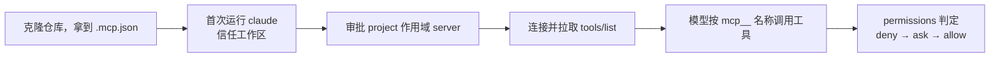

# .mcp.json 团队共享配置指南

本文件只给人看，说明项目根目录 `.mcp.json` 的作用、共享边界与团队用法，是 [[README|README]] 里「项目级配置」在 MCP 这一层的展开。

> [!important] 位置边界：它不在 `.claude/` 里
> **`.mcp.json` 就在项目根这一层**：Claude Code 从**项目根目录**读它，路径是 `<项目根>/.mcp.json`，不是 `<项目根>/.claude/.mcp.json`。同属项目根的还有 `CLAUDE.md` / `CLAUDE.local.md`，见 [[README|README]]。
> 它与 `.claude/` 并列，**不属于** `.claude/` 的内容（项目根与 `.claude/` 的分工见 [[README|README]]）。放错位置不会报错，只会静默读不到。
> 本指南属于 `docs/`，只给人看，不参与任何加载机制。

> [!note] 本文口径
> 文中「本目录」一律指**这个项目的根目录**，**不是**本文件所在的 `docs/`。
> 2026-11-07 按 Claude Code 官方文档与 MCP 规范 `2026-07-28` 逐条核对，来源列在文末。官方没写明的，一律写「待确认」，不靠推断补齐；涉及版本门槛的地方标了版本号，落地前以当期官方页为准。
> **两套版本要分开看**：Claude Code 是客户端（配置怎么读、怎么审批），MCP 规范是服务器侧协议（消息怎么发、工具怎么声明）。第四、五节按前者，第六节按后者。

## 一、这个文件是干什么的

`.mcp.json` 是 Claude Code 三种 MCP 配置作用域里**唯一的团队共享层**。官方原话：「Check `.mcp.json` into version control so everyone on your team gets the same MCP tools and services.」

它只做一件事：声明**连哪些 MCP 服务器、用什么传输、怎么启动或怎么连**。服务器本身、凭据、工具实现都不在这个文件里。

| 作用域 | 加载范围 | 是否团队共享 | 存储位置 |
| --- | --- | --- | --- |
| `local`（默认） | 仅当前项目、仅自己 | 否 | `~/.claude.json` 中该项目路径下的 `mcpServers` |
| `project` | 仅当前项目 | **是，通过版本控制** | 项目根 `.mcp.json` |
| `user` | 本机所有项目、仅自己 | 否 | `~/.claude.json` |

> [!warning] 「MCP 的 local scope」不是 `.claude/settings.local.json`
> 官方专门点明这个术语差异：MCP 的 local 作用域配置存在**家目录**的 `~/.claude.json`；普通本地设置才用项目里的 `.claude/settings.local.json`。两者都叫 local，改错文件不会生效也不会报错。

同名服务器出现在多个作用域时，优先级为 **local > project > user > 插件提供的 server > claude.ai 连接器**；组织通过 `managedMcpServers` 下发的定义排在最上（需 2.1.259+）。官方强调：命中后**整条 server 条目采用高优先级来源，字段不跨作用域合并**——不要指望用 local 只覆盖一个 `headers`。

它**不是**三样东西：

- 不是授权文件：写进去 ≠ 生效，交互式会话要先审批（见 5.2）。
- 不是凭据仓库：token 一律走环境变量、OAuth 或动态 header（见 4.3、6.3）。
- 不是权限规则：能不能调某个工具由 `permissions` 的 `mcp__...` 规则决定，那是 `settings.json` 的事，见 5.4。

## 二、适用对象与共享边界

**谁该用**：需要让全组拿到同一套外部能力的人——只读数据库查询、内部 API、浏览器自动化、代码托管平台等。判断标准很简单：**连接方式可以公开、凭据不能公开**。

| 该进 `.mcp.json`（提交） | 不该进（留在本机） |
| --- | --- |
| server 名称、传输类型、endpoint 域名 | API key、token、DSN 里的密码、client secret |
| 启动命令与参数模板 | 个人账号、个人回调端口 |
| `${VAR}` / `${VAR:-default}` 占位 | 机器专属绝对路径（用变量替代） |
| 静态 header 名、超时值、公开的 OAuth client ID | 已展开的 `Authorization` 值 |
| 无敏感信息的 `oauth` 元数据 | OAuth 凭据（Claude Code 存系统钥匙串 / 凭据文件） |

三条共享边界，都跟「提交成功 ≠ 全组生效」有关：

1. **凭据不进版本控制。** 用 `${VAR}` 展开、`oauth` 流程或 `headersHelper` 动态取；`claude mcp add` **不校验凭据**，占位值也会被保存，直到连接时才报 401。
2. **审批是每人本机的决定。** 批准结果存在**未随仓库分发**的 settings 文件里（用户设置、托管设置、`--settings`、未被跟踪的 `.claude/settings.local.json`）。官方原话：「A cloned repository can't approve its own servers」——提交在项目 `.claude/settings.json` 里的 `enableAllProjectMcpServers` / `enabledMcpjsonServers`，在**未信任**文件夹会被忽略，server 停在 `⏸ Pending approval`。反过来，`disabledMcpjsonServers` 在任何设置文件里都生效。
3. **无法弹审批的会话会直接加载。** `claude -p`、Agent SDK 会话、项目线程外的云会话，以及 `bypassPermissions` 且设了 `skipDangerousModePermissionPrompt` 的会话，都不显示审批提示。要排除项目级 server，用 `disabledMcpjsonServers`、`--setting-sources`（SDK 用 `settingSources`），或 `--strict-mcp-config` + `--mcp-config` 只加载显式传入的配置。

## 三、与数据库、API、浏览器等外部能力的关系

MCP 是**通道**，不是能力本身。`.mcp.json` 只描述「连到哪、怎么起」；真正的能力由服务器通过 `tools/list` 声明（见 6.1）。连上之后，Claude Code 把这些工具以 `mcp__<server>__<tool>` 的名字挂进上下文，模型才看得见、才能调。

| 外部能力 | 常见承载方式 | 典型传输 | `.mcp.json` 里写什么 | 边界 |
| --- | --- | --- | --- | --- |
| 数据库 | 本地 stdio 进程（DB 查询 server） | stdio，省略 `type` | `command`、`args`、`env`；DSN 用 `${MCP_DB_DSN}` | 官方明确建议连接串里用**只读数据库用户**，让 Claude 发出的查询改不了数据 |
| 内部 / 第三方 API | 远程 MCP endpoint | `type: "http"` | `url`、`headers`、`oauth`、`timeout` | 401 / 403 走 OAuth 或 header 鉴权；一旦配了 `Authorization` header，Claude Code 就不再对该 server 回退到 OAuth |
| 浏览器 / 本地自动化 | 本机 stdio 进程 | stdio | `command`、`args` | 能读写本地文件、能出网，属于权限最高的一类，应单独审批、单独限权 |

三条容易混淆的边界：

- **能力范围由服务器决定，不由 `.mcp.json` 决定。** 文件里写的是连接信息；服务器返回哪些工具、工具能碰到什么数据，是服务器侧实现。
- **`permissions` 管的是「Claude 能不能调这个工具」，管不到「server 内部能访问什么」。** 给 `mcp__db__query` 开了 `allow`，不等于数据库账号只读；反过来，只读账号也挡不住模型把查到的内容写到别处。
- **sandbox 不覆盖 MCP server。** 本目录 `settings.json` 开了 sandbox，但官方说明内置 `Read` / `Edit` / `Write` / `WebFetch`、**MCP server**、hook 都在沙箱外（见 [[docs/settings_README|settings_README]] 第六节第 5 条）。别把沙箱当成 MCP 的护栏。

## 四、字段与配置约定（对照本目录 `.mcp.json`）

本目录当前文件是从 `{}` 补齐的**写法样本**，两条 server 都是占位，不是可运行服务：

```json
{
  "mcpServers": {
    "example-readonly-db": {
      "command": "npx",
      "args": ["-y", "@example/readonly-db-mcp", "--dsn", "${MCP_DB_DSN}"],
      "env": { "MCP_LOG_LEVEL": "info" },
      "timeout": 30000
    },
    "example-internal-api": {
      "type": "http",
      "url": "${MCP_API_BASE_URL:-https://mcp.example.com}/mcp",
      "headers": { "Authorization": "Bearer ${MCP_API_TOKEN}" },
      "timeout": 30000
    }
  }
}
```

> [!warning] 这两条默认是连不上的
> `@example/readonly-db-mcp` 是占位包名，`mcp.example.com` 是保留域名，`${MCP_DB_DSN}` / `${MCP_API_TOKEN}` 需要自己注入。所以未审批时看到 `⏸ Pending approval`、审批后看到 `✘ Failed to connect` 都属**预期**。实际启用前，替换成团队实际的 server，或整条删除。

| 字段 | 含义 | 适用 | 本目录取值 |
| --- | --- | --- | --- |
| `mcpServers` | 唯一顶层包装键 | 全部 | 两个占位 server |
| `command` | stdio 启动命令 | stdio | `npx` |
| `args` | 命令参数数组 | stdio | 包名、`--dsn ${MCP_DB_DSN}` |
| `env` | 注入 server 进程的环境变量 | stdio | `MCP_LOG_LEVEL=info` |
| `type` | 传输类型 | 远程 | `http`；stdio 条目**省略** |
| `url` | MCP endpoint | http / sse / ws | `${MCP_API_BASE_URL:-https://mcp.example.com}/mcp` |
| `headers` | 请求头 | http / sse / ws | `Authorization: Bearer ${MCP_API_TOKEN}` |
| `timeout` | 单次工具调用的硬超时（毫秒） | 全部 | `30000` |

字段之外的规矩，全都是会静默出错的点：

1. **有 `url` 就必须有 `type`。** 官方把「`url` 但无 `type`」判为配置错误，报错原文 `MCP server "<name>" has a "url" but no "type"; add "type": "http" ...`；因为 Claude Code 会把**没有 `type` 的条目一律当 stdio 读**。反过来，stdio 条目的规范写法就是省略 `type`。
2. `type` 可取 `http`（`streamable-http` 是别名，方便直接抄服务器文档）、`sse`、`ws`、`sdk`。`sse` 已弃用；`ws` 只能在 JSON 里配，`claude mcp add --transport` 不接受 `ws`；`sdk` 只允许 SDK host / 桌面应用注册，Claude Code 会跳过这类条目并告警。
3. **环境变量展开**支持 `command`、`args`、`env`、`url`、`headers` 五处，写法 `${VAR}` 或 `${VAR:-default}`。变量未设且无默认值时，配置**仍会加载**，只是保留 `${VAR}` 字面文本并在 `claude mcp list` 给 missing-variable 警告。变量设为空字符串算「已设置」，`${VAR:-default}` 会展开成空串而不是默认值。
4. **凭据类变量会被刻意读空。** 远程 server 的 `url` / `headers` 里，`ANTHROPIC_API_KEY`、`ANTHROPIC_AUTH_TOKEN`、`AWS_BEARER_TOKEN_BEDROCK`、`HTTPS_PROXY`、`NPM_TOKEN` 等一律读成空且不给警告。官方理由：防止项目的 `.mcp.json` 把 Claude Code / 云厂商凭据发给它自己命名的服务器。要用这类值，先复制到一个自定义变量名再引用。
5. **`CLAUDE_PROJECT_DIR` 别直接写进 `command`。** 它由 Claude Code 注入到 **server 进程**环境（Node 读 `process.env.CLAUDE_PROJECT_DIR`，Python 读 `os.environ[...]`），不在 Claude Code 自身环境里；若确实要在 `command` / `args` 里引用，必须写成 `${CLAUDE_PROJECT_DIR:-.}`，否则会保留字面量。插件提供的配置例外，可直接替换。
6. **严格 JSON。** 不能有 `//` 注释、尾逗号；值里的隐藏首尾空白（粘贴 token 带上换行）Claude Code **不会 trim**，会原样使用并给警告。
7. **命名约束**：server key 只用字母、数字、连字符、下划线；`workspace`、`claude-in-chrome`、`computer-use`、`Claude Preview`、`Claude Browser` 是保留名，会被跳过或拒绝。
8. **名称会影响权限规则**：工具名是 `mcp__<server>__<tool>`，server 名里的 `.` 和空格会变成 `_`。改 server 名等于改所有权限规则、skill 的 `allowed-tools`、hook matcher 的匹配对象。

## 五、团队成员：启用 → 验证 → 调用



### 5.1 前置准备（每人一次）

- 装好 server 依赖：stdio 条目要能在 `PATH` 里解析到 `command`（`npx` / `uvx` / 二进制）；远程条目要能出网到该域名。
- 注入本机变量：`export MCP_DB_DSN=...`、`export MCP_API_TOKEN=...`，写进 shell profile 或本机密钥管理，**不要写进仓库**。
- 记录客户端版本：审批、SSE 自动回退（2.1.265+）、`/mcp reconnect all`（2.1.284+）都有版本门槛。

### 5.2 启用

1. 在项目根交互式运行 `claude`，先接受 **workspace trust** 对话框；没信任之前，仓库里提交的审批设置一律不生效。
2. 接受项目级 server 的审批提示。官方原话：「For security reasons, Claude Code prompts for approval in interactive sessions before using project-scoped servers from `.mcp.json` files.」
3. 需要预批准的，在**自己本机**的设置里写 `enableAllProjectMcpServers`（全部批准）或 `enabledMcpjsonServers`（按名字批准）；官方索引标注这两个键 Scope 为 `Any file`。不要提交到项目 `.claude/settings.json` 指望它替全组批准——未信任文件夹会忽略它。
4. 想彻底拒绝某条：任何设置文件里的 `disabledMcpjsonServers` 都生效，且在**所有权限模式下**阻挡。
5. 改主意了：`claude mcp reset-project-choices` 清空项目审批选择，下次重新弹。

### 5.3 验证

| 命令 | 看什么 |
| --- | --- |
| `claude mcp list` | 每台 server 的健康状态；同名跨作用域冲突、缺失变量、隐藏空白的警告也在这里 |
| `claude mcp get <name>` | 单台详情；连接失败时 `Issue:` 行给出 HTTP 状态码或错误码 |
| `/mcp`（会话内） | 状态面板、OAuth 登录、Disable / Clear authentication / Reconnect |
| `claude doctor` | 被拒绝的配置条目 |
| `claude --debug-file /tmp/claude-debug.log` | 搜 `never expanded toward a remote server`，定位凭据变量被读空 |
| `--output-format stream-json` | `system/init` 的 `mcp_server_errors` 字段，供脚本化校验 |

状态对照：

| 显示 | 含义 | 处理 |
| --- | --- | --- |
| `⏸ Pending approval (run claude to approve)` | 项目级 server 未批准 | 交互式运行 `claude` 审批 |
| `✔ Connected` | 连接成功 | — |
| `! Needs authentication` | 需要登录 | `claude mcp login <name>` 或在 `/mcp` 里登录 |
| `✘ Failed to connect` | 连接失败，状态行附错误详情，`get` 有 `Issue:` | 查凭据 / 网络 / endpoint；详情里的类凭据文本会被脱敏 |
| `✘ Rejected (see disabledMcpjsonServers in settings)` | 被拒绝名单拦下 | 从 `disabledMcpjsonServers` 移除 |
| `⊘ Disabled for this project (re-enable via /mcp)` | 本机禁用 | `/mcp` 面板重新启用 |
| `✘ Blocked by enterprise managed policy` | 组织策略拒绝 | 找管理员确认哪条 allowlist / denylist 拦下 |

连接失败细节里的 URL 只显示 scheme + host（+ 端口），路径与查询串不出现，展开后的完整 URL 永不出现——排查时别指望从这里看到 token。批量重连可用 `/mcp reconnect all`（2.1.284+；更早版本报 `MCP server "all" not found`）。

### 5.4 调用

- 连上后工具以 `mcp__<server>__<tool>` 挂进上下文，用自然语言描述任务即可触发；`/mcp` 可查看每台 server 的工具清单。
- 是否免询问由 `permissions` 决定，判定顺序固定 **deny → ask → allow**，规则写得越细**不会**改变顺序。三种写法：
  - `mcp__<server>__*` 或 `mcp__<server>`：该 server 全部工具
  - `mcp__<server>__<tool>`：单个工具
  - `mcp__*`：**只能**用于 `deny` / `ask`；放进 `allow` 会被跳过，不会自动批准任何东西
- `allow` 的通配符必须锚定在具体 server 前缀后（`mcp__github__get_*` 合法，`mcp__*` 非法）。server 名里的 `.` / 空格写 `_`；含 `__` 或末尾 `_` 的 server 名要用完整 wildcard 形式。
- settings 文件里**带括号的** `mcp__` 规则会被跳过；要按参数匹配 MCP 工具，改用 `--disallowedTools`。
- 输出与耗时上限：单工具输出超 10,000 tokens 告警，默认上限 25,000 tokens（`MAX_MCP_OUTPUT_TOKENS` 可调），成功文本结果超 50,000 字符无论上限都落盘成文件。条目里的 `timeout` 是硬墙钟（毫秒），进度通知不会延长它；小于 1000 的值被忽略、回落到 `MCP_TOOL_TIMEOUT`。

### 5.5 个人改动（不进提交）

```bash
claude mcp add --transport http my-api --scope local https://mcp.example.com/mcp    # 只在本项目、只对自己
claude mcp add --transport http my-api --scope user https://mcp.example.com/mcp     # 本机所有项目
claude mcp add --transport stdio my-db --env MCP_DB_DSN=... -- npx -y <package>      # stdio
claude mcp remove my-api --scope local
claude mcp login <name>        # OAuth 登录；无浏览器时加 --no-browser
claude mcp logout <name>       # 清除凭据；remove 之前先 logout 才能在授权服务器侧撤销 token
```

> [!note] `--` 与 `--env` 的两个坑
> stdio 的 `--` 之后全部原样交给 server；不加 `--`，server 自己的 `--port` 会被当成 Claude Code 的参数。`--env` 后面若直接跟 server 名，会被当成另一组 `KEY=value` 而报错，中间至少要隔开一个选项（如 `--transport stdio`）。

## 六、外部 MCP 服务器一侧的准备与要求

这一节给**提供 server 的人**看：把服务接进团队 `.mcp.json` 之前，服务器侧要满足什么。按 MCP 规范 `2026-07-28` 写；仍实现早期修订版的 server 见 6.9。

### 6.1 可用工具声明

- 在 `capabilities` 里声明 `tools`（可选 `listChanged`）；声明了就**必须**响应 `tools/list`。工具集合可以为空、可以随时间变化，但**不得**因连接不同、或受同一连接上其他请求的副作用而变化；按请求携带的授权范围返回不同工具集合是允许的。
- `tools/list` 支持 `cursor` / `nextCursor` 分页；官方建议**稳定排序**，同一集合顺序一致，便于客户端缓存工具清单、提升 prompt cache 命中。
- 每个 Tool 定义的字段：`name`、`title`、`description`、`icons`、`inputSchema`、`outputSchema`、`annotations`。`inputSchema` 必须是合法 JSON Schema 对象（不能为 `null`），未写 `$schema` 时默认 **JSON Schema 2020-12**；无参数工具推荐 `{"type":"object","additionalProperties":false}`。声明了 `outputSchema` 就必须返回符合它的 `structuredContent`。
- 工具名建议 1–128 字符、大小写敏感、只含 `A-Z a-z 0-9 _ - .`，且在**单个 server 内唯一**。跨 server 重名由客户端消歧，不要依赖 `serverInfo.name` 保证全局唯一。
- `description` 是模型判断「调不调、怎么调」的主要依据，要写清前置条件、副作用与返回结构；`annotations` 只是提示，官方要求客户端**除非来自可信 server，否则一律视为不可信**，不能当授权依据。
- 工具清单变化时，向订阅了 `notifications/tools/list_changed` 的客户端发通知。

### 6.2 配置约定（协议层）

- **传输二选一**：`stdio`（客户端拉起的子进程）或 `Streamable HTTP`（单一 MCP endpoint，每个 JSON-RPC 请求一次 POST）。旧 `HTTP+SSE` 自 `2025-03-26` 起弃用，新实现不要采用；Claude Code 侧 `--transport sse` 只为兼容保留。
- **`2026-07-28` 是无状态协议**：处理请求所需的全部信息都在请求本身，服务器**不得**依赖同一连接上的先前请求来建立上下文（能力、协议版本、客户端身份）。每个请求的 `_meta` 必带 `io.modelcontextprotocol/protocolVersion` 与 `io.modelcontextprotocol/clientCapabilities`，`clientInfo` 可选；缺必填项用 `-32602` 拒绝。跨请求状态必须由客户端每次显式传入的标识符引用。
- Streamable HTTP 的每个 POST **必须**带 `MCP-Protocol-Version` 头，且值与 body 的 `_meta` 一致，不一致返回 `400` + `HeaderMismatch`（`-32020`）；还需 `Mcp-Method`，`tools/call` / `resources/read` / `prompts/get` 还需 `Mcp-Name`。未实现该版本返回 `400` + `UnsupportedProtocolVersionError`（`-32022`）；未实现的方法返回 `404` + `-32601`。这一版**移除了 GET 流端点与协议级 session**，`Mcp-Session-Id` 应被忽略。
- stdio 的硬约束：消息是**逐行、UTF-8、不含内嵌换行**的 JSON-RPC；`stdout` **只允许**写合法 MCP 消息，日志一律走 `stderr`；客户端也不得往 `stdin` 写非 MCP 消息。进程应在 `stdin` 关闭 / EOF 时尽快退出。
- 服务器文档里要公布支持的协议版本，并给出可直接复制的 `.mcp.json` 片段（含 `type`；远程条目尤其不能漏）。

### 6.3 鉴权与访问控制

- **HTTP 传输**：授权是可选的，但一旦启用，官方要求遵循 OAuth 2.1 体系：OAuth 2.1（draft-ietf-oauth-v2-1-13）、RFC 6750、RFC 8414 / OIDC Discovery、RFC 8707、RFC 9728、RFC 9207。要点：
  - MCP server 作为 **resource server**，**必须**实现 RFC 9728；客户端必须用它发现授权服务器。
  - 客户端在授权请求与 token 请求里都**必须**带 `resource` 参数，指向 server 的 canonical URI；PKCE 必做。
  - 每次 HTTP 请求都带 `Authorization: Bearer <token>`，**token 不得放进 URL query**；server 必须校验 token 是签发给自己的 audience，只接受自己授权服务器签发的 token，**不得接受或转发其他 token**。
  - 错误码：`401` 未授权 / token 无效，`403` scope 不足（可用 `WWW-Authenticate` 的 `insufficient_scope` 指明所需 scope），`400` 授权请求格式错。
  - RFC 7591 动态客户端注册在 `2026-07-28` **已弃用**，迁移到 Client ID Metadata Documents；授权服务器不支持动态注册时，团队要预注册 client ID（Claude Code 用 `--client-id`，secret 存系统钥匙串，不进配置）。
- **stdio 传输**：官方明确**不应**走这套 OAuth，凭据从环境变量取。对应 `.mcp.json` 的 `env` / `${VAR}`；不要把凭据写进 `args`，那会暴露在进程列表里。
- **最小权限**：数据库用只读账号，API 用最小 scope，按工具粒度做访问控制。官方 `tools` 页对 server 的强制要求是：校验所有工具输入、实现恰当的访问控制、对工具调用限流、对输出做消毒。
- 配了 `Authorization` header 后，Claude Code 会把 header 当作该 server 的凭据，**不再回退 OAuth**；若走网关还需要额外 header，用 `headersHelper` 动态生成，或保持 `Authorization` 为空、改用 `claude mcp login`。

### 6.4 环境依赖

- 明确列出运行时与版本（Node / Python / 容器 / 二进制）、包来源、是否需要联网安装；`npx -y` / `uvx` 这类会在首次启动拉包，离线环境要预装或固定版本。
- 列出必需环境变量、默认值以及凭据注入方式，并区分「团队共享的连接参数」与「每人的密钥」。
- stdio server 可读 `CLAUDE_PROJECT_DIR`（Claude Code 注入）解析项目相对路径；它是**稳定的项目根**，会话中增减工作目录不会变。
- 需要限制文件系统范围时：Claude Code 文档提到 `roots/list`（返回启动目录加 `--add-dir` 授权的目录），但 MCP 规范 `2026-07-28` 已把 **Roots 列入弃用**，迁移路径是把目录或文件通过工具参数、资源 URI 或 server 配置传入。新 server 不要依赖 roots。

### 6.5 启动与可用性

- stdio：由 Claude Code 拉起子进程；关闭 `stdin` → 等待退出 → 超时才强杀（POSIX 上 SIGTERM 升级到 SIGKILL）。进程异常退出时客户端应重启；协议无状态，在途请求直接丢失、可重试。
- Streamable HTTP：单一 endpoint 支持 POST，响应为单个 JSON 对象或该请求作用域内的 SSE 流；**必须校验 `Origin` 头**（无效返回 `403`，防 DNS rebinding），本地部署**应只绑定 127.0.0.1**，并**应**对所有连接做认证。
- 可用性核对：启动超时 `MCP_TIMEOUT`、工具调用超时 `MCP_TOOL_TIMEOUT` / 条目 `timeout`、空闲窗口（HTTP / SSE / WS 默认 5 分钟，stdio 默认 30 分钟，`CLAUDE_CODE_MCP_TOOL_IDLE_TIMEOUT` 可调）。提供明确的连接失败信息，别让客户端只看到一个超时。
- 工具行为要可预期：长任务用显式标识符与进度通知，不要靠连接状态串上下文。

### 6.6 错误处理

两类错误不能混：

| 类型 | 用于 | 返回方式 | 客户端处理 |
| --- | --- | --- | --- |
| 协议错误 | 未知工具、请求结构不合法、server 内部错误 | JSON-RPC `error`（`code` + `message`），如未知工具 `-32602` | 模型通常难以据此自纠 |
| 工具执行错误 | API 失败、输入校验失败、业务规则不满足 | `result` 里 `isError: true` + `content` 文本 | 客户端**应**交给模型，让它改参数重试 |

- 错误码用标准 JSON-RPC `-32700`、`-32600` ~ `-32603`；`-32020` ~ `-32099` 由 MCP 规范保留（`-32020` HeaderMismatch、`-32021` MissingRequiredClientCapability、`-32022` UnsupportedProtocolVersion），实现**不得**自定义占用；应用自定义错误码应落在 JSON-RPC 保留区间之外。`-32000` ~ `-32019` 是遗留段，新实现不要用。
- 工具执行错误的文本要**可操作**：说清哪个参数错、期望什么格式、当前值是什么，便于模型自纠；不要把堆栈、凭据、内部主机信息塞进去。
- HTTP 层 `401` / `403` / `400` 语义见 6.3；Claude Code 会把 401 / 403 标成 `! Needs authentication`，并在 `claude mcp get` 的 `Issue:` 里显示脱敏后的状态与错误文本。

### 6.7 日志

> [!warning] 协议级 Logging 已弃用
> `logging/setLevel` + `notifications/message` 在 `2026-07-28` 被标记 **Deprecated**（SEP-2577），最早可在 2027-07-28 之后的首个修订版移除。官方迁移路径：**stdio 走 `stderr`，结构化观测走 OpenTelemetry**。新 server 不要再实现它。

- 无论走哪条通道，日志**不得**包含凭据 / 密钥、个人身份信息、可被用来攻击的内部系统细节（协议原文为 MUST NOT）；建议限流、固定 logger 名、去掉敏感字段。
- stdio 的 `stderr` 是日志通道，但客户端**不应**把 `stderr` 输出等同于错误；`stdout` 被日志污染会直接破坏协议帧。
- 审计侧记录工具调用与结果摘要（官方建议客户端 log tool usage for audit purposes），别记完整凭据或完整响应体。
- 客户端排查用 `claude --debug-file <path>`；服务器侧把日志接进团队现有的 OTel / 日志平台，不要依赖 Claude Code 转发。

### 6.8 安全边界

- **工具是 model-controlled**：模型会自行发现并调用工具。官方要求始终保留 human-in-the-loop 的拒绝能力，界面上明确展示正在暴露哪些工具，调用时给出可见提示与确认。
- **prompt injection**：官方警告「Verify you trust each server before connecting it. Servers that fetch external content can expose you to prompt injection risk.」——取外部内容（网页、Issue、工单、邮件）的 server 风险最高，返回内容要消毒，敏感操作要二次确认。
- server 侧 MUST：校验全部输入、做访问控制、限流、消毒输出；客户端 SHOULD：敏感操作前确认、调用前展示参数、结果交给模型前校验、设超时、留审计日志。
- 只读不是可选项：数据库只读账号、API 最小 scope、浏览器类 server 单独审批。`.mcp.json` 的审批提示**只是知情同意，不是安全边界**——`claude -p` / SDK / 云会话根本不弹提示。
- 别把 `annotations` 当授权依据；别用 `x-mcp-header` 传密码 / token / PII，header 对网络中间节点可见。

### 6.9 维护变更规范

- **版本要显式**：server 文档写清支持的 MCP 协议修订版与客户端最低版本。`2026-07-28` 是无状态、无连接级 `initialize` 的一代，早期版本靠握手；规范给出的兼容路径是客户端先用 `server/discover` 探测、失败才回退 `initialize`，且**不得**用单一错误码判定 legacy。Claude Code 侧有 v1 / v2 runtime 与 `MCP_PROTOCOL_NEGOTIATION=legacy` 兼容开关，升级前先在测试项目验证。
- **工具名、参数、返回结构属于公开契约**：改名或改 `inputSchema` 会让团队已写的 `mcp__<server>__<tool>` 权限规则、hook matcher、skill `allowed-tools` 静默失配。变更走 PR，附前后对照与回归结果。
- **新增 / 下线工具**要同步 `listChanged` 通知与文档；下线前给过渡期，别让模型在会话中途拿到一份已经不能用的工具清单。
- **endpoint / 包名 / 凭据变量名变更**要同时改 `.mcp.json`、团队变量注入说明和本文第四节的表；`url` 拼写变化（scheme / host 大小写、默认端口、末尾斜杠）在 Claude Code 里可能被判为**同一个 endpoint**，改名要说清楚。
- 每次变更后的最小回归：`claude mcp list` 全绿 → `claude mcp get <name>` 无误 → `/mcp` 里工具数量与名称符合预期 → 跑一个只读工具确认返回结构。

## 七、配置生效检查（改完 `.mcp.json` 之后）

| # | 检查 | 命令 / 位置 | 通过标准 |
| --- | --- | --- | --- |
| 1 | JSON 合法 | `python3 -m json.tool .mcp.json > /dev/null` | 退出码 0；无注释、无尾逗号 |
| 2 | 路径正确 | 项目根目录下 `ls .mcp.json` | 在**项目根**，不在 `.claude/` 内 |
| 3 | 无凭据 | `git diff .mcp.json` | 只有 `${VAR}` 占位，没有已展开的 token / DSN / secret |
| 4 | 远程条目有 `type` | 目视或 `claude mcp list` | 每个含 `url` 的条目都写了 `type`；无 `url without type` 报错 |
| 5 | 变量已注入 | 本机检查 `MCP_` 前缀变量 | 必需变量都有值，且未命中官方「读空名单」 |
| 6 | 无隐藏空白 | `claude mcp list` | 无 `Leading or trailing whitespace in: ...` 警告 |
| 7 | 无重名冲突 | `claude mcp list` | 无同名跨作用域告警；冲突用 `claude mcp remove <name> --scope <scope>` 清理 |
| 8 | 审批状态 | `claude mcp get <name>` | 不是 `⏸ Pending approval` / `✘ Rejected` / `✘ Blocked by enterprise managed policy` |
| 9 | 连接健康 | `claude mcp list` 或 `/mcp` | `✔ Connected`；失败看 `Issue:` |
| 10 | 工具清单 | `/mcp` 详情 | `tools/list` 返回的工具名与文档一致、数量符合预期 |
| 11 | 权限规则仍匹配 | 项目 `settings.json` 的 `permissions` | `mcp__<server>__...` 规则与当前 server 名一致；拼错的 deny / ask 会有启动告警 |
| 12 | 只读调用 | 一个无副作用工具 | 返回结构符合 `outputSchema`；输出未触发 10,000 tokens 告警 |

> [!note] 提交前区分「谁的检查」
> 第 1–4、11 项是**仓库级**检查，可在 PR / CI 里做；第 5–10、12 项依赖每人本机的凭据、网络与审批决定，只能由成员自己跑。`.mcp.json` 提交成功 ≠ 全组生效。

## 八、常见问题排查

| 现象 | 原因 | 处理 |
| --- | --- | --- |
| `MCP server "<name>" has a "url" but no "type"` | 远程条目漏了 `type`，被当 stdio 读 | 补 `"type": "http"`（或 `sse` / `ws`） |
| `⏸ Pending approval` 一直不消失 | 未在工作区运行交互式 `claude`；或审批写在未信任文件夹的项目 settings 里 | 运行 `claude` 接受 trust 并审批；`claude mcp reset-project-choices` 可重来 |
| 有人从没看到审批提示 | `claude -p` / Agent SDK / 云会话 / `bypassPermissions` 会跳过审批直接加载 | 用 `disabledMcpjsonServers`、`--setting-sources` 或 `--strict-mcp-config` 明确排除 |
| `✘ Failed to connect` 且带 401 | token 无效 / 缺失 / 被刻意读空 | `claude mcp login <name>`；`claude --debug-file` 搜 `never expanded toward a remote server`；把凭据换成自定义变量名 |
| `! Needs authentication` | 远程 server 返回 401 或 403 | `/mcp` 或 `claude mcp login`；OAuth 只作用于 HTTP server，配了 `Authorization` header 就不会回退 OAuth |
| `✘ Rejected` | `disabledMcpjsonServers` 命中 | 从任意设置文件移除；该键在所有权限模式下都生效 |
| `Leading or trailing whitespace in: headers.Authorization` | 粘贴 token 带了换行 | Claude Code 不 trim，直接编辑配置删掉空白 |
| 同名 server 连到了「另一个」endpoint | 多作用域重名，整条取最高优先级且字段不合并 | `claude mcp remove <name> --scope <scope>`；官方也会在 `list` 里告警 |
| server 被跳过并提示改名 | 用了保留名，或 key 含非法字符 | 改成只含字母、数字、`-`、`_` 的名字 |
| stdio server 一启动就断、解析报错 | `stdout` 混进了日志、`console.log`、进度条 | 日志全部改走 `stderr`，`stdout` 只留逐行 JSON-RPC |
| `npx -y ...` 首次启动慢或直接超时 | 首次拉包 / 离线 | 预装并固定版本；调 `MCP_TIMEOUT`；确认 `PATH` 能解析 `command` |
| 工具输出被截断或落盘成文件 | 10,000 tokens 告警、25,000 tokens 上限、50,000 字符落盘 | server 侧分页或压缩返回；必要时调 `MAX_MCP_OUTPUT_TOKENS` |
| 工具调用迟迟不返回 | 硬超时 / 空闲窗口 / 两分钟后转后台任务 | 调条目 `timeout`（毫秒，小于 1000 忽略）或 `MCP_TOOL_TIMEOUT`；长任务用显式标识符 |
| `MCP server "all" not found` | `/mcp reconnect all` 需 2.1.284+ | 升级客户端，或逐台 Reconnect |
| 插件 server 的权限规则不生效 | 工具名是 `mcp__plugin_<plugin>_<server>__<tool>`，裸 server key 匹配不到 | 用完整 plugin-scoped 名称写规则 |
| `type: "sdk"` 条目被跳过 | 只有 SDK host / 桌面应用能注册进程内 server | 改成 `http` / `stdio`，或交给 SDK 应用注册 |

## 九、团队使用注意事项

1. **凭据永远不进提交。** 用 `${VAR}`、`oauth`、`headersHelper`；`claude mcp add` 不校验凭据，占位值也会被接受，直到连接时才发现 401。
2. **审批是知情同意，不是安全边界。** 每人本机的批准与 workspace trust 都不随仓库分发，无交互会话根本不弹提示；`disabledMcpjsonServers` 是唯一可写进项目设置、且在任何权限模式下始终生效的拒绝项。
3. **最小权限先行**：数据库只读账号、API 最小 scope、浏览器类 server 单独审批。官方对数据库给出的原话就是连接串里用只读用户。
4. **取外部内容的 server 一律当作不可信输入**，防 prompt injection；敏感操作保留人工确认。
5. **别把改 server 名当小事**：`mcp__<server>__<tool>` 是权限规则、hook matcher、skill `allowed-tools` 的匹配键，改名会让这些规则静默失配。
6. **`local` / `user` 作用域是个人层**，同名会整条压过 project 定义且字段不合并；排查「我这边和别人不一样」先看 `claude mcp list` 的重名告警。
7. **不要把 `.mcp.json` 放进 `.claude/`**（见开头的位置边界）；它和 `.claude/settings.json` 不在同一层。
8. **SSE 与协议级 Logging 都在弃用路上**：新配置用 `type: "http"`，新 server 用 `stderr` / OTel，别照旧博客抄 `logging/setLevel`。
9. **变更走 PR + 回归**：改 endpoint / 包名 / 工具名 / 凭据变量名时，同步本文第四节的表、团队变量注入说明与权限规则，按第七节跑一遍最小回归。
10. **版本写进基线**：审批、`/mcp reconnect all`、SSE 自动回退、managed MCP 优先级都有版本门槛；跨版本比较行为前先记录各自的 `claude --version`。

## 十、待确认（官方未写明 / 本目录无验证信息）

| 项 | 需要确认什么 |
| --- | --- |
| `enabledMcpjsonServers` / `disabledMcpjsonServers` / `enableAllProjectMcpServers` 的类型与默认值 | 官方逐键参考的索引只给出 Description 与 Scope（`Any file`），本次取到的正文未包含类型 / 默认值 / 示例；本文只按描述讲用法，未臆断取值 |
| `alwaysLoad` | 官方 MCP 文档只说 `ws` 条目可接受与 `http` 相同的该字段，未给出取值类型与语义 |
| `type: "stdio"` 是否为显式合法值 | 官方只写明「没有 `type` 的条目按 stdio 读」并列出 `http` / `streamable-http` / `sse` / `ws` / `sdk`，未把 `stdio` 列为 JSON `type` 取值；本目录按省略写法处理 |
| 本目录两条 server | 均为占位写法样本，包名与域名不可运行；实际启用前需替换为团队实际 server 或删除 |
| 团队实际客户端版本 | 本目录未记录；本文所有版本门槛需按当期 CLI 核对 |
| `headersHelper`、discovery cache、插件 / 托管 MCP 的进阶配置 | 官方文档有对应章节，本文按「聚焦配置与使用」的范围未展开 |

## 十一、官方参考

| 内容 | 链接 |
| --- | --- |
| Claude Code：MCP 配置、作用域、审批、排查 | https://code.claude.com/docs/en/mcp |
| Claude Code：设置文件与优先级 | https://code.claude.com/docs/en/settings |
| Claude Code：逐键参考（MCP 相关键的 Description / Scope） | https://code.claude.com/docs/en/settings-reference |
| Claude Code：权限规则与 `mcp__` 语法 | https://code.claude.com/docs/en/permissions |
| MCP 规范 `2026-07-28`：基础协议、错误码、无状态 | https://modelcontextprotocol.io/specification/2026-07-28/basic/index |
| 同上：Tools（工具声明、`isError`、安全） | https://modelcontextprotocol.io/specification/2026-07-28/server/tools |
| 同上：stdio | https://modelcontextprotocol.io/specification/2026-07-28/basic/transports/stdio |
| 同上：Streamable HTTP | https://modelcontextprotocol.io/specification/2026-07-28/basic/transports/streamable-http |
| 同上：Authorization | https://modelcontextprotocol.io/specification/2026-07-28/basic/authorization/index |
| 同上：Logging（已弃用） | https://modelcontextprotocol.io/specification/2026-07-28/server/utilities/logging |
| 同上：Deprecated Features | https://modelcontextprotocol.io/specification/2026-07-28/deprecated |
| 同上：版本清单 | https://modelcontextprotocol.io/llms.txt |

文档站有对应的 `/zh-CN/` 中文版，例如 https://code.claude.com/docs/zh-CN/settings 。
